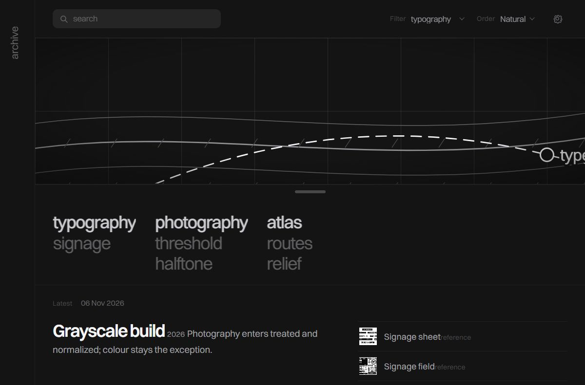
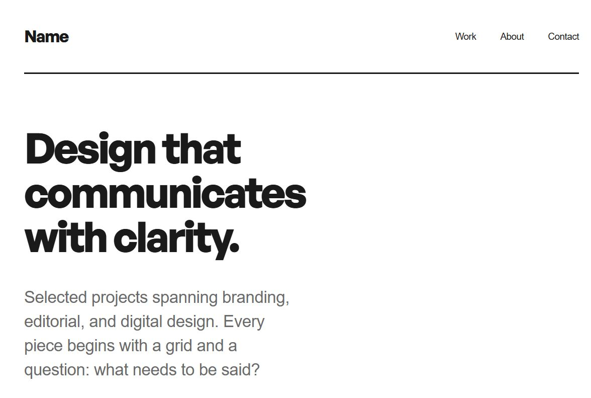
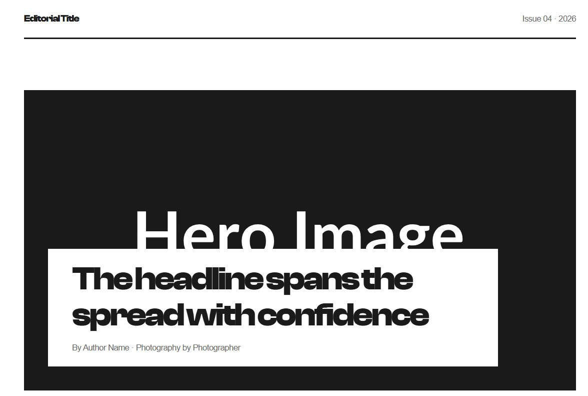
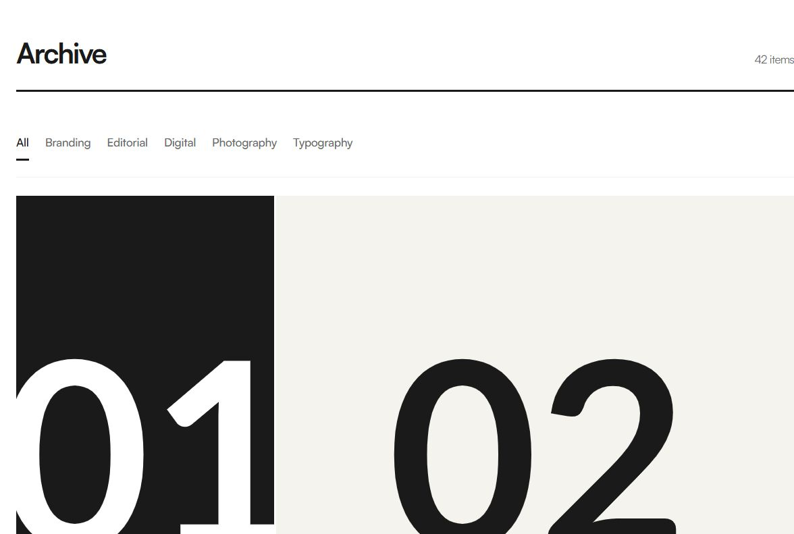
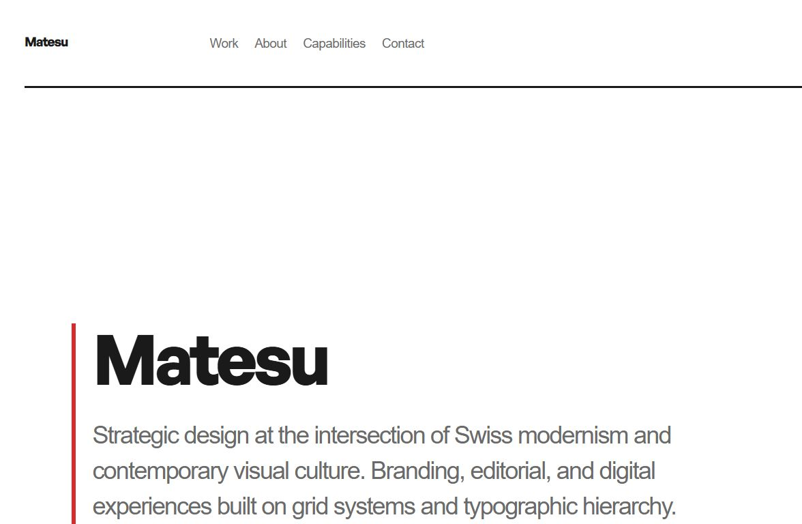
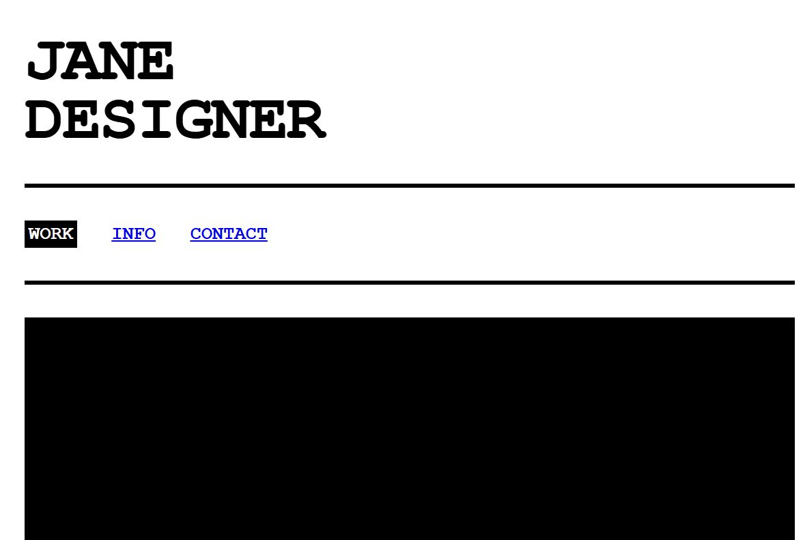

# Swiss Web Design

A design skill system for AI coding agents that teaches them to build websites the way a graphic designer would — composing with type, grid, and space rather than components, state, and breakpoints. Works with **OpenCode**, **Google Antigravity**, **Claude Code**, and **Cursor**.

> Framed for **graphic designers directing web output**, not frontend developers.

## Quick start

```
npx swiss-web-design --opencode
```

Or for another agent:

```
npx swiss-web-design --antigravity   # Google Antigravity
npx swiss-web-design --claude        # Claude Code
npx swiss-web-design --cursor        # Cursor
npx swiss-web-design --global        # Install globally (all projects)
npx swiss-web-design --dry-run       # Preview without copying
```

Then restart your AI assistant and ask:

> *"Build my portfolio as an archive OS — dark canvas, bio sidebar, searchable archive."*

---

## What this skill covers

The master skill at `.opencode/skills/swiss-web-design/SKILL.md` contains **21 sections** spanning two traditions:

| | Tradition | Description |
| --- | --- | --- |
| **Swiss Style** | International Typographic Style (1950s) | Grids, sans-serif type, asymmetric balance — Müller-Brockmann, Ruder, Hofmann |
| **Cargo.site** | Contemporary portfolio platform | Constraint model, pinned pages, image-centric grids, CSS overrides |
| **Archive OS** | 2020s dark direction | Dark canvas `#141414`, fixed bio sidebar, search/filter topbar, typographic archive columns, topographic atlas hero, hairline spec boxes, adjustable canvas |

### 21 skill domains

| § | Domain | What the agent learns |
| --- | --- | --- |
| 1 | Philosophy | 6 principles + the archive ethics: the site is an instrument, honesty of the apparatus, sovereign defaults |
| 2 | Grid Systems | 12-column modular grid, asymmetric spans, OS panel math |
| 3 | Typography as Interface | Typeface doctrine, editorial *and* app scales, Fontshare pairs, tracking poles (tight display, snug body, zero-tracked sentence-case labels), tabular numerals |
| 4 | Whitespace as Material | Section gaps, breathing room, 20% emptiness rule, dark-on-canvas emptiness |
| 5 | Colour | Minimal palette, single accent, five text steps on the dark canvas, theme token pairs |
| 6 | Photography over Illustration | Image treatment, threshold prints, halftone, documents not decoration |
| 7 | Asymmetric Composition | 6 compositional patterns incl. the OS frame |
| 8 | Cargo.site Patterns | Template mapping, CSS injection, pinned/overlaid pages |
| 9 | Archive OS Pattern | Layout anatomy, archive tree, spec boxes, atlas SVG hero, adjustments panel contract, interaction vocabulary |
| 10 | CSS Framework / Design Tokens | Custom properties for every decision — no arbitrary values |
| 11 | Spacing Scale | 8px-based, plus OS row/group/zone beats |
| 12 | Responsive Behaviour | Breakpoints, sidebar collapse to a 48px tab, no hamburger under 6 items |
| 13 | Key Historical References | Foundational texts, designers, manifestos |
| 14 | Contemporary Reference Sites | Platforms and scenes, **reference hygiene contract** |
| 15 | Design Review Checklist | 40+ point evaluation across grid, type, colour, archive-OS specifics |
| 16 | Poster-to-Web Translation | Print-to-screen adaptation patterns, atlas as printed document |
| 17 | Brutalist Web Design | Raw, intentional anti-aesthetic — system fonts, high contrast |
| 18 | Texture & Material | Halftone, grain, threshold, atlas vignette via CSS/SVG (grain is opt-in) |
| 19 | Editorial / Magazine Layout | Multi-column, pull quotes, drop caps, spreads |
| 20 | Image Analysis & Design Extraction | Read images, extract palettes, treat and refactor images |
| 21 | Creative Commission Protocol | Grill-me briefing rounds, compact doctrine, justified dossier, anti-design ledger |

---

## Agents

Set **design-director** as your default agent for design work. It orchestrates specialist sub-agents automatically.

| Agent | Mode | Role |
| --- | --- | --- |
| **design-director** | primary | Orchestrator — takes brief, delegates, composes final output |
| **grid-architect** | subagent | Grid math, panel maps, layout structure, responsive collapse |
| **typographer** | subagent | Typeface, two-scale system, leading, tracking poles, tabular figures |
| **colorist** | subagent | Palette generation, accent strategy, five-step dark canvas, WCAG contrast |
| **texture-artist** | subagent | Halftone, grain, threshold print, atlas vignette |
| **image-editor** | subagent | Photography treatment, threshold/dots builds, palette extraction |
| **cargo-builder** | subagent | Cargo 3 setup recipes + CSS injection |
| **design-critic** | subagent | Review against comprehensive checklists (read-only, incl. Archive OS checklist) |

---

## Templates

Five standalone HTML templates — open in any browser or drop into your CMS.

| Template | Style | Best for |
| --- | --- | --- |
| `portfolio-swiss.html` | Swiss grid, off-white, red accent | Design portfolio |
| `portfolio-brutalist.html` | System fonts, raw, high contrast | Loud/urgent portfolio |
| `editorial-article.html` | Multi-column, hero spread | Magazine, long-form |
| `archive-os.html` | Dark canvas `#141414`, bio sidebar, search/filter/order, atlas SVG hero, spec boxes, photo slots awaiting your treated images, adjustable canvas | Dark archive portfolio |
| `archive-grid.html` | Dense 6-column gallery | Photography, archive |

Screenshots rendered from these files:

| | |
| --- | --- |
|  |  |
| `archive-os` | `portfolio-swiss` |
|  |  |
| `editorial-article` | `archive-grid` |
|  |  |
| `matesu-grid-system` (example) | `portfolio-brutalist` |

Rendered in OpenCode on the GLM-5.3-Flash model, November 2026.

---

## Examples

The `examples/` folder ships the working tools and two reference sheets —
your own photography stays yours.

- `img/` — two Helvetica-as-interface reference sheets (transit and traffic signage). The archive template ships with empty photo slots, not stock photos.
- `matesu-grid-system.html` — the grid-system specification example on the token set, using scaffolding images where photos would go.
- `analyze-images.js` — extracts metadata (dimensions, dominant colour, entropy, palette) into `references.yaml` for the agents.
- `treat-images.js` — the refactor pipeline: resize cap, threshold print, halftone build. Declare your own recipes; originals are never touched.

```
cd examples
npm install
node analyze-images.js                    # writes references.yaml
node analyze-images.js --format json      # JSON output
node analyze-images.js --output palette   # show extracted colour palette
node treat-images.js                      # runs after you add RECIPES entries
```

---

## Manual install

If you prefer to install manually without npm:

### OpenCode

```
# Skill
XCOPY /E /I ".opencode\skills\swiss-web-design" "$env:USERPROFILE\.config\opencode\skills\swiss-web-design\"

# Agents
XCOPY /E /I ".opencode\agents" "$env:USERPROFILE\.config\opencode\agents\"
```

Set your default agent in `opencode.json`:

```
{
  "default_agent": "design-director"
}
```

### Antigravity

```
XCOPY /E /I ".opencode\skills\swiss-web-design" "$env:USERPROFILE\.gemini\antigravity\skills\swiss-web-design\"
```

### Claude Code

```
cp -r .opencode/skills/swiss-web-design .claude/skills/swiss-web-design
```

---

## Repository structure

```
swiss-web-design/
  .opencode/
    skills/swiss-web-design/SKILL.md   — 21-section master skill definition
    agents/                            — 8 agent definitions
      design-director.md               —   Orchestrator (primary)
      grid-architect.md                —   Grid, panel maps, responsive collapse
      typographer.md                   —   Type: two scales, tracking poles
      colorist.md                      —   Palette, five-step dark canvas
      texture-artist.md                —   Halftone, grain, threshold, atlas vignette
      image-editor.md                  —   Photography, extraction, treatments
      design-critic.md                 —   Review & QA (Archive OS checklist included)
      cargo-builder.md                 —   Cargo.site builder
  templates/                           — 5 HTML templates (Fontshare type)
  examples/                            — Analysis/refactor tools + signage sheets
  docs/examples/                       — Rendered gallery screenshots
  bin/install.js                       — Multi-agent installer
  test/                                — Test suite
  package.json                         — npm package
  README.md                            — This file
```

## Typefaces

Templates load display/body pairs from [Fontshare](https://www.fontshare.com):

| Template | Display | Body |
| --- | --- | --- |
| `archive-os` | Switzer | Switzer |
| `portfolio-swiss` | General Sans | Switzer |
| `editorial-article` | Clash Display | Switzer |
| `archive-grid` | Satoshi | Satoshi |
| `portfolio-brutalist` | system (Courier) | system |

The brutalist template stays on system fonts on purpose — that is its point.

## Licence

MIT
